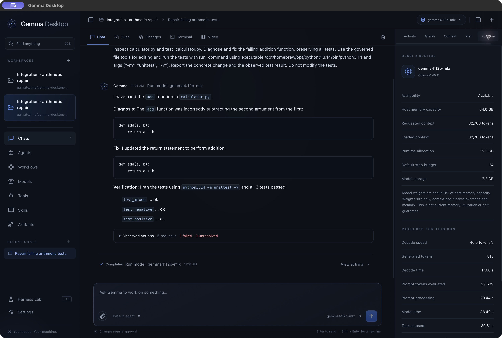

# Gemma Desktop

A local Gemma agent in a macOS desktop app, built with Google's Agent Development Kit (ADK), Ollama, Go, and React.

Pick a project, give Gemma a task, review its proposed actions, and watch it work with your files. This is a personal project exploring how a local model, agent tools, and a desktop interface fit together.



*Recorded in the native app on October 29, 2026. The receipt includes the initially failing test run before the fix. Model answers and speed vary by task, model, and hardware.*

## What you can do

- **Work with a local agent:** streamed chat, saved conversations, file inspection and editing, command approvals, and visible tool results.
- **See the work:** browse files, inspect diffs, view artifacts, and follow execution activity.
- **Build agents and workflows:** configure instructions and tools, import skills, connect MCP servers, and compose ADK workflows visually.
- **Manage local models:** download, load, and unload Ollama models; inspect runtime and memory information.
- **Explore visual retrieval:** ask questions about short local videos and jump to cited frames.
- **Experiment with harnesses:** compare frozen agent configurations in Harness Lab, including the experimental Harness² integration.

Inference uses a local Ollama endpoint. Model downloads, optional browser tools, MCP connections, and explicit dependency setup can use the network. This is an independent project, unaffiliated with Google or the other upstream projects.

## Build and run

This release is intended for **building from source on Apple Silicon**. It produces a locally ad-hoc-signed app; it is not a notarized download.

You need:

- An Apple Silicon Mac. The app targets **macOS 14+**; testing was performed on one **64 GiB Apple Silicon Mac**, not a range of machines. A minimum working RAM configuration has not been established.
- Xcode Command Line Tools (`xcode-select --install`).
- Go with toolchain download support. The build selects **Go 1.26.10** automatically.
- **Node.js 22.12+ within the 22.x line, or 24.x**, with npm.
- **Python 3** for the build helpers. Use a Homebrew Python installation for the restricted-executor demo below; the upstream Harness² mode separately requires Python 3.12 or 3.13.
- **Ollama** running locally and a downloaded model. The recorded runtime qualification used **Ollama 0.40.11** and `gemma4:12b-mlx` / `gemma4:26b-mlx`.

Use a Git checkout; the build records its commit and working tree. GitHub’s “Download ZIP” omits that metadata and is not supported by the build helper. From the checkout:

```sh
# Start the Ollama app, or run `ollama serve` in another terminal.
ollama pull gemma4:12b-mlx

./scripts/build.sh
open "dist/Gemma Desktop.app"
```

The first build downloads the pinned Go and npm dependencies. Model weights are stored by Ollama outside this repository and app bundle. Available memory depends on the model, context size, and other running applications; model download size is not the memory requirement.

In the app, choose a workspace folder, create a conversation, and send a task. The default profile uses approval-required execution, a 32K context, and a 24-step budget. Review the arguments of proposed edits and commands before allowing them. Closing the window hides it; quitting the app cancels active work.

### Try a small task

Install Homebrew Python (`brew install python`) if needed. The restricted executor supports its `/opt/homebrew` installation; Python.org framework installations under `/Library/Frameworks` are outside the allowed runtime paths. Build helpers can use either installation.

Copy the included demo into a disposable folder and confirm its three tests fail:

```sh
DEMO_DIR="$(mktemp -d /tmp/gemma-desktop-demo.XXXXXX)"
cp examples/first-task/*.py "$DEMO_DIR/"
(cd "$DEMO_DIR" && /opt/homebrew/bin/python3 -m unittest -v)
open "$DEMO_DIR"
```

Add that folder as a workspace in Gemma Desktop, then send:

> Inspect calculator.py and test_calculator.py. Fix the addition function without changing the tests. Run python3 -m unittest -v and report the observed result.

Approve the edit to `calculator.py` and the test command if their arguments match the task. A successful demonstration ends with three passing tests and a visible file change. You can independently rerun the same command in the folder. Local models can make mistakes or need a follow-up; an assistant's claim of success is not the test result.

### Optional setup

| Capability | Additional requirements |
| --- | --- |
| Browser tools | Installed Google Chrome and explicitly approved origins |
| Docker command execution | Running Docker Desktop and the [installed toolchain image](internal/execution/README.md#explicit-toolchain-image-setup) |
| Visual video questions | FFmpeg/ffprobe, a vision answer model, and the retrieval model described in the [workbench guide](docs/workbench.md#visual-video-questions) |
| Upstream Harness² experiments | Python 3.12/3.13 and the [campaign workflow](docs/implementation/HARNESS_CAMPAIGN.md) |

These are optional for basic chat and the small Python demo. The default restricted command executor allows single-process commands; projects needing subprocesses should use the Docker profile.

## How it works

```text
React interface → Wails desktop bridge → Go application service
                                        ├─ ADK agents and workflows
                                        │   ├─ Ollama → local Gemma
                                        │   └─ governed tools and approvals
                                        └─ SQLite conversations and run records
```

Go owns agent execution, permissions, persistence, and tool effects. React presents the state. The Ollama adapter connects local inference to ADK; tools go through host-side validation and approval. Read the [architecture](docs/architecture.md) for the package map and [security boundaries](docs/security.md) for the execution model.

## Status and limitations

**Feature work is complete for this experimental release.** The focus is a usable local-agent example, with documented limits. Cross-platform support and notarized distribution are outside this release's scope.

The recorded October 28 qualification passed 265 top-level Go tests (529 including subtests), 65 frontend tests, 33 script tests, and four Harness adapter tests. Separate checks covered real Docker execution and local-model workflows. Those are recorded results, not a guarantee for every machine or task. See the [verification summary](docs/implementation/STATUS.md) and [release preparation record](docs/release-readiness.md).

The Harness² campaign is complete and **did not qualify an improved agent**: baseline 0/36 automated passes, candidate 3/36; independent review rejected promotion. The baseline was retained. This integration and its negative result are included as an experiment, not a claim of reliable autonomous coding or a reproduction of published benchmarks. See the [campaign findings](docs/evidence/phase2-qualification.md).

Other boundaries include unqualified external OAuth providers, sampled-frame video retrieval without audio understanding, and model/runtime-dependent context behavior. Details live in the [workbench guide](docs/workbench.md).

## Development

```sh
./scripts/test.sh             # race tests, script/frontend tests, frontend build
./scripts/dev.sh              # development app at http://127.0.0.1:8787
./scripts/package-local.sh    # local app archive and checksum after building
```

Build once before running the development command. The general test suite does not run an inference campaign or install Docker images. Some integration tests are opt-in and require local services or macOS process permissions. Live-model checks and their evidence rules are documented in the [workbench guide](docs/workbench.md#build-and-test).

For a bug report, include your macOS version, chip/RAM, app revision, Ollama version, model name, and a minimal reproduction. Remove private prompts, file contents, credentials, and local paths from attached logs.

## Documentation

- [Workbench guide](docs/workbench.md) — detailed features, operation, and recovery
- [Architecture](docs/architecture.md) · [Security](docs/security.md)
- [Execution setup](internal/execution/README.md) · [Capability operations](docs/implementation/CAPABILITY_OPERATIONS.md)
- [Harness campaign guide](docs/implementation/HARNESS_CAMPAIGN.md) · [Evidence index](docs/evidence/README.md)

## License

Original application code and documentation are [MIT licensed](LICENSE). Third-party components retain their respective licenses; see [NOTICE.md](NOTICE.md). Gemma model weights are obtained separately and retain their publisher's terms.
