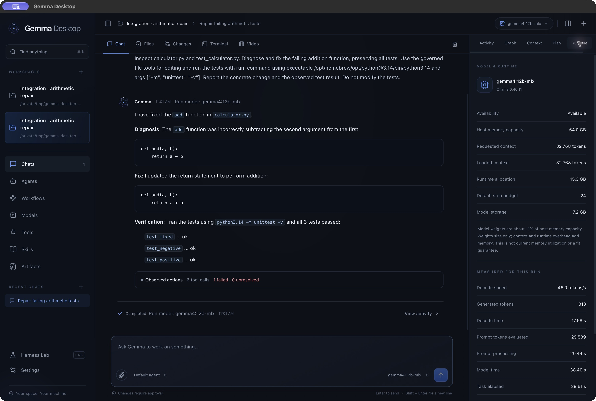

# Gemma Desktop

An experimental local Gemma agent in a macOS desktop app, built with Google's Agent Development Kit (ADK), Ollama, Go, and React.

Pick a project, give Gemma a task, review its proposed actions, and watch it work with your files. This is a personal project exploring how a local model, agent tools, and a desktop interface fit together.



*Recorded in the native app on October 29, 2026. The receipt includes the initially failing test run before the fix. Model answers and speed vary by task, model, and hardware.*

## What you can do

- **Work with a local agent:** streamed chat, saved conversations, file inspection and editing, command approvals, visible tool results, and an optional check command that confirms the task.
- **See the work:** browse files, inspect diffs, view artifacts, and follow execution activity.
- **Build agents and workflows:** configure instructions and tools, import skills, connect MCP servers, and compose ADK workflows visually.
- **Manage local models:** download, load, and unload Ollama models; inspect runtime and memory information.
- **Explore visual retrieval:** ask questions about short local videos and jump to cited frames.
- **Experiment with harnesses:** compare frozen agent configurations in Harness Lab, including the experimental Harness² integration.

Ollama is the default local inference backend. Full-installer builds also support explicitly installed and checked managed completion runtimes; each runtime/model/context combination must pass its own protocol check before use. Video and embeddings stay on Ollama. Model downloads, optional browser tools, MCP connections, and explicit dependency setup can use the network. This is an independent project, unaffiliated with Google or the other upstream projects.

## Build and run

This release is intended for **building from source on Apple Silicon**. It produces a locally ad-hoc-signed app; it is not a notarized download.

You need:

- An Apple Silicon Mac. The app targets **macOS 14+**; testing was performed on one **64 GiB Apple Silicon Mac**, not a range of machines. A minimum working RAM configuration has not been established.
- Xcode Command Line Tools (`xcode-select --install`).
- Go with toolchain download support. The build selects **Go 1.26.10** automatically.
- **Node.js 22.12+ within the 22.x line, or 24.x**, with npm.
- **Python 3** for the build helpers. Use a Homebrew Python installation for the restricted-executor demo below; the upstream Harness² mode separately requires Python 3.12 or 3.13.
- **Ollama** running locally and a downloaded model. The recorded model runs used **Ollama 0.40.11** and `gemma4:12b-mlx` / `gemma4:26b-mlx`.

Use a Git checkout; the build records its commit and working tree. GitHub’s “Download ZIP” omits that metadata and is not supported by the build helper. From the checkout:

```sh
# Start the Ollama app, or run `ollama serve` in another terminal.
ollama pull gemma4:12b-mlx

./scripts/build.sh --ollama-only
open "dist/Gemma Desktop.app"
```

The explicit `--ollama-only` source build works without managed-runtime archives. It includes the desktop app and Harness resources, and uses your separately installed Ollama. It omits the bundled oMLX/mlx-serve runtime catalog and archives, so managed-runtime installation, model acquisition, and qualification are unavailable from this bundle. It does not import an existing private managed-runtime installation.

The first build downloads the pinned Go and npm dependencies. Model weights are stored by Ollama outside this repository and app bundle. Available memory depends on the model, context size, and other running applications; model download size is not the memory requirement.

`./scripts/build.sh` without an option remains the full-installer build. It requires reviewed managed-runtime archives prepared through [the runtime packaging workflow](packaging/runtimes/README.md); missing or corrupt inputs fail the build. Both modes record their explicit `buildMode` in `dist/build-info.json`, verify source and frontend inputs after signing, and label the result locally ad-hoc-signed rather than notarized. Ollama-only provenance records `runtimeResourcesIncluded: false` and `runtimeResourcesVerified: false`.

In the app, choose a workspace folder, create a conversation, and send a task. The default profile uses approval-required execution, a 32K context, a 40-step budget and temperature 1.0. Explicit saved settings remain unchanged. Review the arguments of proposed edits and commands before allowing them. Closing the window hides it; quitting the app cancels active work.

### Try a small task

Install Homebrew Python (`brew install python`) if needed. The restricted executor supports its `/opt/homebrew` installation; Python.org framework installations under `/Library/Frameworks` are outside the allowed runtime paths. Build helpers can use either installation.

Copy the included demo into a disposable folder and confirm its three tests fail:

```sh
DEMO_DIR="$(mktemp -d /tmp/gemma-desktop-demo.XXXXXX)"
cp examples/first-task/*.py "$DEMO_DIR/"
(cd "$DEMO_DIR" && /opt/homebrew/bin/python3 -m unittest -v)
open "$DEMO_DIR"
```

Add that folder as a workspace in Gemma Desktop, then send:

> Inspect calculator.py and test_calculator.py. Fix the addition function without changing the tests. Run python3 -m unittest -v and report the observed result.

Optionally, before sending, click **Check** in the composer and enter `python3 -m unittest -v`. When Gemma finishes after changing files, Gemma Desktop runs that command itself, read-only, and the run shows **Task verification passed** or **Task remains unverified**.

Approve the edit to `calculator.py` and the test commands if their arguments match the task. A successful demonstration ends with three passing tests and a visible file change. You can independently rerun the same command in the folder. Local models can make mistakes or need a follow-up; an assistant's claim of success is not the test result.

### Optional setup

| Capability | Additional requirements |
| --- | --- |
| Browser tools | Installed Google Chrome and explicitly approved origins |
| Docker command execution | Running Docker Desktop and the [installed toolchain image](internal/execution/README.md#explicit-toolchain-image-setup) |
| Visual video questions | Qualified FFmpeg/ffprobe 8.1, a vision answer model, and the retrieval model described in the [workbench guide](docs/workbench.md#visual-video-questions) |
| Upstream Harness² experiments | Python 3.12/3.13 and the [campaign workflow](docs/implementation/HARNESS_CAMPAIGN.md) |

These are optional for basic chat and the small Python demo. The default restricted command executor allows single-process commands; projects needing subprocesses should use the Docker profile.

## How it works

```text
React interface → Wails desktop bridge → Go application service
                                        ├─ ADK agents and workflows
                                        │   ├─ Ollama → local Gemma
                                        │   └─ governed tools and approvals
                                        └─ SQLite conversations and run records
```

Go owns agent execution, permissions, persistence, and tool effects. React presents the state. Completion adapters connect local inference to ADK; tools go through host-side validation and approval. Read the [architecture](docs/architecture.md) for the package map and [security boundaries](docs/security.md) for the execution model.

## Status and limitations

**Reliability work — 5–6 November 2026.** Calculation guidance now asks the agent to validate parsed samples, report coverage, check totals/units and investigate surprising empty results before answering. Caller budgets can narrow a run's saved deadline. An opt-in finishing reserve can request one bounded final status at a tool/model boundary; cancelled, exhausted or incomplete work still cannot count as success. App and pilot-tool temperature defaults now use 1.0 while preserving explicit stored values. These implementation changes do not guarantee correct arithmetic or final delivery.

**Measured scope — 5–6 November.** One fresh 26B pass produced **8 independently clear successes out of 15 attempts**, one uncredited answer-contract ambiguity and six failures; 12 attempts delivered a final answer and nine passed automatic checks. Supplied-test repairs were stronger at 4/5 correct, but only four delivered, so the acceptance target still failed. Everyday work reached 3/7 clear successes and stretch coding 1/3. Both reliability gates remain unmet. This is an experimental assistant that requires independent checking.

**Sampling and limits.** New trials use temperature 1.0, matching [Google’s guidance](https://huggingface.co/google/gemma-4-26B-A4B-it#1-sampling-parameters). The controlled comparison passed nine attempts at each temperature across three repeated everyday cases; it established no accuracy advantage. Of three fresh calculation tasks, one was correct and two failed to provide the required final answer. One task created an extra helper outside its allowed-file list inside the admitted workspace; no platform permission escalation or outside-workspace write was observed. The [dated record](docs/implementation/RELIABILITY_PUBLICATION_2026-11-05.md) and [aggregate evidence](docs/evidence/reliability-round3-summary-2026-11-05.json) separate actual correctness, delivery and immutable automatic grades, and record software/build evidence. Repeated qualification and matched 12B/E4B comparisons remain follow-up work.

**Historical October qualification.** The 28 October 2026 source checks recorded 265 top-level Go tests (529 including subtests), 65 frontend tests, 33 script tests and four Harness adapter tests. The [October status snapshot](docs/implementation/STATUS.md), [October release preparation](docs/release-readiness.md) and [4 November task pilot](docs/evidence/task-pilot-2026-11-04.md) retain their original scope and limits.

**Historical Harness² result — October 2026.** The earlier campaign did not qualify an improved agent: baseline 0/36 automated passes, candidate 3/36; independent review rejected promotion and retained the baseline. That result remains in the [campaign findings](docs/evidence/phase2-qualification.md). Later implementation or test passes do not replace its grades or reproduce published benchmark results.

**Media qualification remains separate.** The media runtime requires FFmpeg/ffprobe 8.1. The 5 November validation host had ffprobe 9.0.2, leaving four known media qualification failures; the full Go suite is not reported as green. Missing optional executables can instead produce skips, which do not qualify the video path. Source compilation, ordinary mocked app delivery and a qualified video workflow are separate results.

Other boundaries include unqualified external OAuth providers, sampled-frame video retrieval without audio understanding, and model/runtime-dependent context behavior. Notarized distribution and cross-platform qualification remain outside the recorded source-build result. Details live in the [workbench guide](docs/workbench.md).

## Development

```sh
./scripts/test.sh             # race tests, script/frontend tests, frontend build
./scripts/dev.sh              # development app at http://127.0.0.1:8787
./scripts/package-local.sh    # local app archive and checksum after building
```

Build once before running the development command. The general test suite does not run an inference campaign or install Docker images. Some integration tests are opt-in and require local services or macOS process permissions. Live-model checks and their evidence rules are documented in the [workbench guide](docs/workbench.md#build-and-test).

For a bug report, include your macOS version, chip/RAM, app revision, Ollama version, model name, and a minimal reproduction. Remove private prompts, file contents, credentials, and local paths from attached logs.

## Documentation

- [Workbench guide](docs/workbench.md) — detailed features, operation, and recovery
- [Architecture](docs/architecture.md) · [Security](docs/security.md)
- [Execution setup](internal/execution/README.md) · [Capability operations](docs/implementation/CAPABILITY_OPERATIONS.md)
- [Harness campaign guide](docs/implementation/HARNESS_CAMPAIGN.md) · [Evidence index](docs/evidence/README.md)

## License

Original application code and documentation are [MIT licensed](LICENSE). Third-party components retain their respective licenses; see [NOTICE.md](NOTICE.md). Gemma model weights are obtained separately and retain their publisher's terms.
