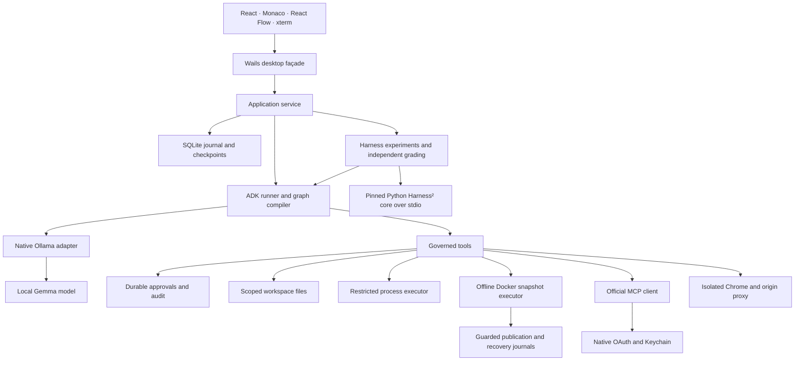

# Architecture

The native `main.go` composition root embeds the Vite production assets and binds one narrow `internal/desktop.Service.Call` method. That façade parses bounded JSON requests and dispatches to the same application service used by the optional headless development server. Runtime objects, database handles, and filesystem roots are never bound directly to the frontend.

| Package | Responsibility |
|---|---|
| `internal/app` | Workspace/session APIs, immutable capability admission, plans/delegation/context, OAuth/Keychain wiring, run ownership and Harness solver/grader adapters |
| `internal/store` | Versioned SQLite schema, entity storage, ordered event journal, recovery, consistent database backups |
| `internal/inference` | Native Ollama endpoints, bounded NDJSON, completion-marker validation, cloud rejection, one active inference lease per client |
| `internal/engine` | ADK model adapter, function tools, full session checkpoint import/export, context and execution budgets, ADK skills |
| `internal/workflow` | Definition validation and compilation into ADK nodes, conditional routing, joins, dynamic fan-out, approval checkpoints |
| `internal/workspace` | Scoped file descriptors, protected-path rules, bounded reads/search, exact revision checks, file operations |
| `internal/execution` | Restricted and Docker executors, private snapshots/dependencies, source publication/recovery, leases, resource measurement, Git inspection and separate user PTY |
| `internal/tools` | Schemas, approval routing, tool catalogue and structured artifacts |
| `internal/mcp` | Official SDK transports, connection/configuration identity, schema discovery, invocation authorization |
| `internal/browser` | Isolated Chrome lifecycle, approved-origin proxy, bounded page extraction and screenshots |
| `internal/harness` | Immutable experiments/revisions/trials/lessons, packet stages, isolated grading orchestration, unseen-task reservations, promotion and rollback |
| `frontend` | Presentation and user interaction; backend state remains authoritative |

Runs are serialized per workspace, preventing two agent runs from editing the same project concurrently. Independent workspaces may progress concurrently; the shared local inference client admits one model request at a time. Workflow children share model/tool/output budgets rather than each resetting the run's allowance. Approval waits do not hold the inference lease.

The database is private application data (`~/Library/Application Support/Gemma Desktop/gemma.db` on macOS by default). Models remain in Ollama's storage. Generated browser artifacts and imported skills live in app-owned subdirectories. No mutable state is written into the signed bundle.

An event's increasing sequence number supports historical ordering. Streaming drafts come from text delta events, while complete final assistant messages and ADK session snapshots are retained separately. A tool intent is committed before its callback can cause an external effect. Results and artifacts are recorded afterward. On interrupted execution, that difference represents uncertainty rather than a retry instruction.

Workflows use immutable per-run graph and resolved-agent snapshots. Validation rejects cycles, malformed routing, and conditional joins affected by the pinned ADK release. Approval pause/resume is tested against the pinned library, including completed predecessors before a join. Unsupported recovery shapes are rejected rather than reported as successful.

The app-owned Python Harness² sidecar communicates through versioned JSON-RPC over
stdio. Go owns all state, authorization and model calls. The pinned upstream files
are verified before import; the sidecar receives bounded public task material and
declarative revisions, not application credentials or grader assertions. Waiting
for a Codex packet is durable and cancellable. Completed trial identifiers are
reused on recovery; uncertain execution is retained as interrupted, never replayed.
