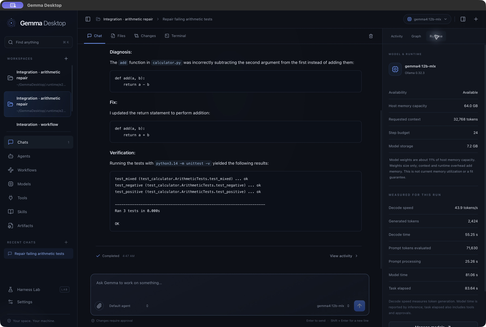
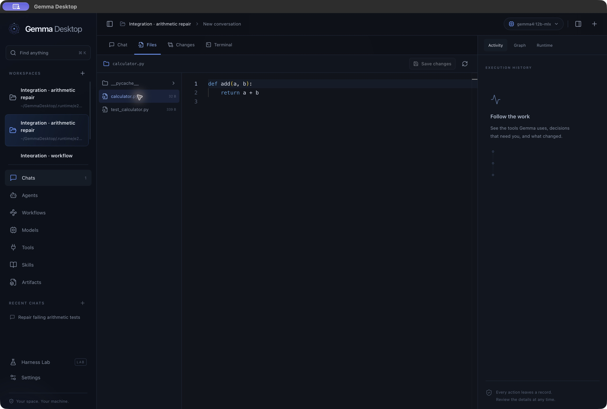
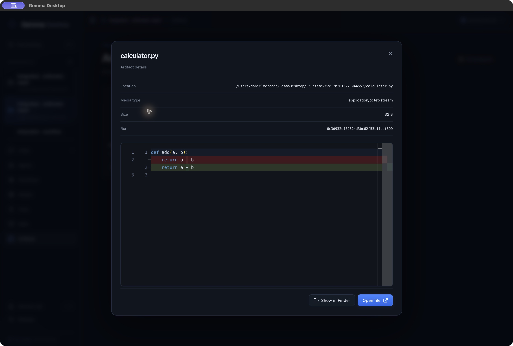
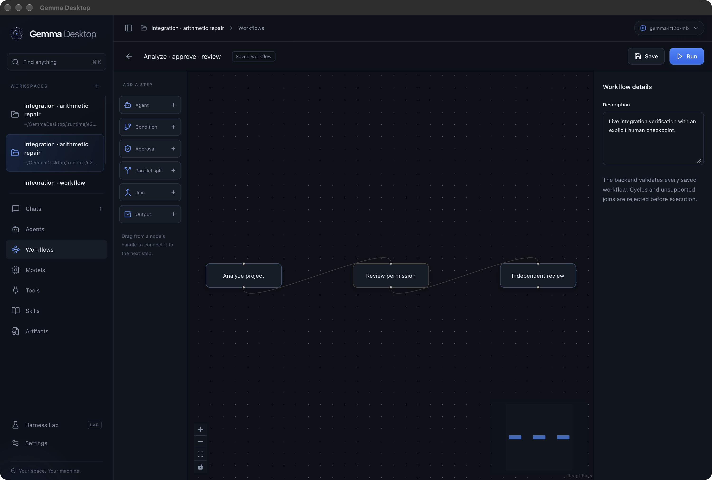

# Gemma Desktop — delivery and verification

27 October 2026 · local release 0.1.0 · Apple Silicon

The application is built and running on the target Mac. Its desktop interface, local inference, ADK execution, governed tools, persistence, workflow editor, model manager, MCP integration, skills, browser tools, and evaluation interface have working implementations. This report distinguishes live end-to-end evidence from automated fixtures and deliberate operational limits.

## Finished application

- App: `/Users/danielmercado/GemmaDesktop/dist/Gemma Desktop.app`
- Local archive: `/Users/danielmercado/GemmaDesktop/dist/GemmaDesktop-local.zip` with adjacent SHA-256 checksum.
- Source: `/Users/danielmercado/GemmaDesktop`
- Executable: native arm64, approximately 49 MiB app bundle, ad-hoc signature verified with `codesign --verify --deep --strict`.
- Model: `gemma4:12b-mlx`, installed in Ollama's model store, outside the app bundle.
- Runtime used: Ollama 0.32.3, started locally with cloud disabled.

Open the app normally for a fresh personal profile. The review window used for screenshots used a separate `.runtime/native-qa` profile containing real generated test projects and their saved history. No example chats or simulated runs are inserted into the normal application profile.

The normal database is `~/Library/Application Support/Gemma Desktop/gemma.db`. A single-process lock prevents two app instances from owning the same data directory. Closing a window hides it; quitting stops owned work. There is no independent background daemon.

## Implemented experience

| Area | Implemented behavior |
|---|---|
| Desktop | Wails 3 native window, dark/light themes, resizable sidebar and inspector, command palette, native folder selection, keyboard controls and explicit errors |
| Conversations | Workspaces, persisted sessions, streaming, attachment context, selectable agents/models, cancellation, tool activity, approvals, saved summaries and runtime metrics |
| Files | Scoped tree and search; Monaco source editing with revision checks; before/after artifacts; Monaco diff inspection; native open/reveal |
| Agents | Named instructions, model choice, step budgets, tool/skill policy and read-only or approval-required modes |
| Workflows | React Flow editor, backend validation, actual ADK sequential/conditional/parallel/join/approval/output nodes and bounded dynamic fan-out; immutable run definitions and supported approval checkpoint resumption |
| Models | Real Ollama inventory, metadata, download/cancel, selection, load/unload/delete, host memory capacity and separate requested/reported context values |
| Execution | Governed file/Git/command tools, exact-argument approvals, durable intents/outcomes, cancellation and output/time budgets; separate approved user PTY terminal |
| MCP | Official Go SDK; workspace-bound stdio and HTTP connections; discovery, schema validation and per-invocation approvals |
| Browser | Isolated Chrome profile, approved-origin networking, navigation, bounded page reading, click/type and screenshot tools |
| Skills | Validated bounded SKILL.md import to app storage; ADK skill toolset integration; instructions do not confer filesystem or script authority |
| Harness Lab | Frozen text inputs and candidate configurations; read-only baseline/candidate trials; answers, timing, usage, tool evidence and input digest retained |
| Recovery | SQLite journal, schema versioning, consistent backups, full ADK session snapshots, interrupted-run reconciliation, approval expiry and no blind side-effect replay |

Go owns orchestration and authority. React owns presentation. The native bridge exposes a narrow JSON application façade; the optional loopback development transport uses that same service. The browser used by tools is separate from the privileged app webview. See [architecture](../architecture.md), [security boundaries](../security.md), and [setup and operation](../../README.md).

## Verification

Target: Mac mini M4 Pro, 64 GiB unified memory, macOS 27.0.1, Xcode 27.1, Node 22.22.3. Go is pinned to 1.26.10. Dependency pins include Wails 3.0.0, ADK-Go v2.6.0, official MCP SDK 1.8.0 and modernc SQLite 1.61.0. The SQLite runtime reports 3.54.1; the app rejects vulnerable older engines before enabling WAL. Older macOS releases are not qualified by this run, even though the bundle minimum is 14.0.

| Check | Result and evidence |
|---|---|
| Native production build | Passed `scripts/build.sh`, TypeScript/Vite build, native Go link, bundle metadata validation and signature verification |
| Backend race suite | 54 passing test/subtest results across ten packages; zero failures. One opt-in live model test skipped in the general suite and passed separately. [Recorded results](../evidence/qualified-tests.json) |
| Real host boundaries | Tests exercised actual Seatbelt command execution/denials, Python unittest, protected Git diffs, cancellation, real Chrome navigation/screenshots and actual PTY operations |
| MCP | Official SDK client/server fixture verified discovery, schema pinning, approval denial and workspace isolation; no production third-party account was required |
| Persistence | Tests cover durable single-use approvals, pre-effect journaling, restart at an approval checkpoint, consumed-checkpoint non-replay, cancellation, exclusive data ownership and evaluation input/configuration freezing |
| Frontend metrics | Three tests passed, covering duration units, decode-vs-task timing, missing/invalid values and memory capacity guidance |
| Frontend dependencies | `npm audit` reports zero findings after a scoped Monaco dependency override to DOMPurify 3.4.17. [Audit result](../evidence/npm-audit.json), [upstream patch](https://github.com/cure53/DOMPurify/releases/tag/3.4.17) |
| Live model/tool/session | Installed Gemma invoked a tool, returned its unknown code `EMBER-7429`, and recalled it after importing a serialized ADK session. One tool call, two first-turn model calls, 3,112-byte snapshot. [Actual output](../evidence/live-model-test.txt) |
| Native UI | Actual `wails://localhost/` bridge loaded saved work. Monaco source rendering, typing, saving and disk contents verified; artifact diff rendered; React Flow graph rendered. Screenshots below |

The production frontend emits a large-chunk advisory for Monaco. It is bundled locally and loaded on demand; the advisory does not fail the build. Native QA found and fixed a WebKit-specific blank editor: inline Blob workers and explicit layout/rendering now work in the actual app, not only in a browser preview.

### Live end-to-end tasks

1. **Coding repair:** the final packaged build completed the task in 41.14 seconds. Gemma inspected a generated Python project with three failing arithmetic tests, changed `return a - b` to `return a + b`, used the approved sandboxed Python command, and produced a completion summary and file artifact. An independent host rerun also passed all three tests. The acceptance driver denied any edit outside `calculator.py` and any command other than the exact prescribed unittest invocation. [Latest evidence](../evidence/live-coding-task.json), [initial successful run used in the screenshots](../evidence/live-coding-task-initial-success.json). This is a single task measurement, not a general performance benchmark.
2. **Cooperating agents:** an analyst read a generated project, paused at a native human approval node, and an independent reviewer checked its constraints and proposed an offline test. The workflow completed with one approval. [Full workflow and execution journal](../evidence/live-workflow.json).
3. **Harness comparison:** two frozen read-only agent configurations analyzed the same frozen input and both completed. Their answers, token usage, timings and input digest are retained. This establishes repeatable execution and evidence collection, not an objective quality ranking. [Evaluation evidence](../evidence/live-evaluation.json).

Earlier failures remain in `docs/evidence/*-first-attempt.json`. The first coding attempt exposed a macOS loader/sandbox issue that was fixed and qualified with real Python execution. The first evaluation prompt ambiguously asked for a relevant test; the model searched for existing tests until its budget ran out. The final evaluation explicitly asks for a proposed new test. Those failed attempts are not counted as successes.

## Reproduce

```sh
./scripts/build.sh
./scripts/test.sh
GEMMA_TEST_SANDBOX=1 GEMMA_TEST_BROWSER=1 GEMMA_TEST_TERMINAL=1 ./scripts/test.sh
GEMMA_LIVE_MODEL=gemma4:12b-mlx ./scripts/live-model-test.sh
```

For complete local model tests, start `./scripts/dev.sh` in a separate terminal, then run `python3 scripts/e2e.py` and `python3 scripts/workflow-e2e.py`. They create their own fixtures under `.runtime`, use the selected local runtime, and save actual evidence. Python, Chrome and the macOS sandbox must be available for the corresponding real-host tests. Development HTTP is loopback-only and is absent from an ordinary app launch.

## Known limitations and external release requirements

- **Agent processes are intentionally single-process.** Network and child process creation are denied. Builds, package managers and MCP stdio launchers needing subprocess trees require a separately qualified container executor. The user terminal has ordinary user-account authority, explicitly approved and never exposed as an agent input tool.
- There are output, time, step, graph and input-size budgets, but no hard aggregate process memory or disk quota. No broad sandbox-security certification is claimed.
- Browser tools permit one approved origin per browser session and do not support credential-field entry or uploads. Arbitrary site compatibility is not claimed.
- MCP OAuth and resumable elicitation flows are not implemented. Local stdio servers must be compatible with the restricted executor.
- Recovery supports explicit native workflow approval checkpoints. Arbitrary crashes between an external effect and its receipt are marked uncertain and never automatically replayed. Conditional joins affected by the pinned ADK version are rejected by validation.
- File checkpoints preserve selected text files, not a complete Git repository snapshot. Revision checks cannot provide an atomic compare-and-swap against every possible external editor.
- Skill import copies SKILL.md only; accompanying resource folders/scripts are not imported or executed. Harness Lab is a bounded text-task comparator, not an autonomous harness optimizer or correctness judge.
- Ollama reported a loaded context of 4,096 for the qualified model despite the 32,768 request. The UI separates the requested value, model metadata and loaded runtime report. Larger effective-context support and all other model variants require their own qualification.
- Verified on this Apple Silicon Mac. Other hardware/OS versions, long-running soak reliability and third-party MCP accounts are not covered by this evidence.
- The local app is ad-hoc signed. Public distribution requires the owner's Developer ID identity and notarytool credentials; `scripts/distribute.sh` is provided but has not been used. No public release or remote repository publication was performed. Choose the original source's license before publishing; upstream licenses are documented in [NOTICE](../../NOTICE.md).

## Actual interface screenshots

The screenshots contain real generated test projects and actual saved execution results.








