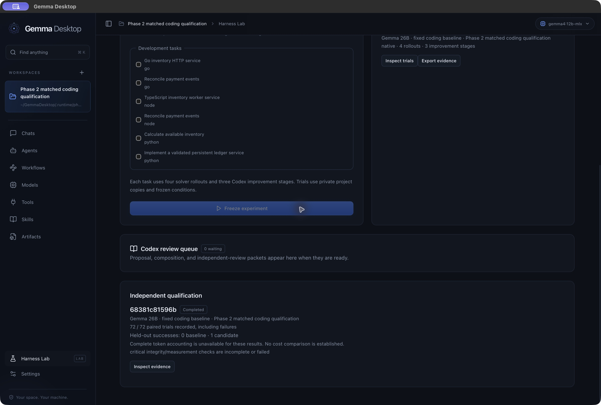
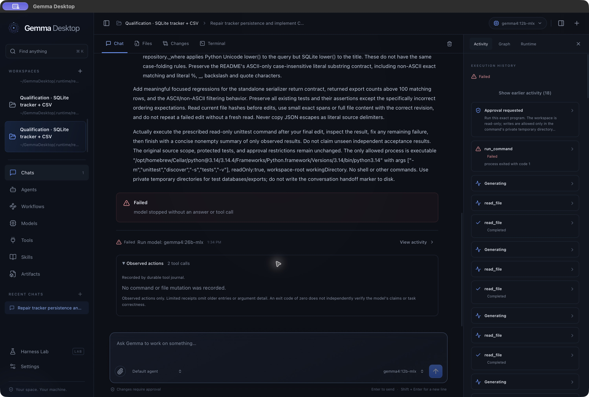

# Gemma Desktop — delivery and verification

28 October 2026 · local release 0.2.1 (build 3) · Apple Silicon

**Capability and Harness² phase delivered; baseline retained.** Milestones A–D, native demonstrations, independent review and the packaged correction release are complete. The frozen 0.2.0 campaign recorded all 72 paired attempts: baseline **0/36** automated passes and candidate **3/36**, including **0/18 versus 1/18** on held-out tasks. Integrity failures, incomplete historical cost accounting and independently reproduced defects prevent promotion. No candidate was activated; no failure was erased.

Release 0.2.1 adds the tested status, token-accounting and saved-observation corrections found during qualification. The current race suite passed 265 top-level tests / 529 including subtests, with 29 explicit opt-in skips; 65 frontend, 33 script and four adapter tests passed. Separate real-Docker checks passed connection loss/recovery, npm build/worker/HTTP, Python multiprocessing/SQLite and all 18 reference fixtures. A separate live native-tool smoke reconciled two measured generations. Video retained six retrieval hits; one yellow flower/star shape remains ambiguous. These new checks do not retroactively qualify the old campaign.

Open [`dist/Gemma Desktop.app`](../../dist/Gemma%20Desktop.app) or use the [local archive](../../dist/GemmaDesktop-local.zip). [Qualification and remaining boundaries](../evidence/phase2-qualification.md), [build identity](../evidence/phase2-correction-build-info.json), [archive checksum](../evidence/phase2-correction-package.sha256), [check summary](../evidence/phase2-correction-qualification-summary.json), and [accepted phase / completed campaign](PHASE2.md) are the current delivery record. The app is locally ad-hoc signed; public distribution is deferred. Owned QA runtimes were stopped, with personal settings and user services preserved.

## Capability phase — current implementation

Agents now select immutable capability revisions, complete hashed skill bundles and resources, per-tool MCP grants, a restricted or Docker executor, and read-only specialists. Run admission freezes permissions and an absolute deadline; recovery retains remaining budgets. Context and Plan inspectors expose provenance and distinguish progress claims from execution evidence. HTTP MCP supports native-browser PKCE OAuth with SDK metadata validation, a bounded explicit-endpoint compatibility path, and Keychain persistence. No external OAuth provider is qualified yet.

Docker commands run offline against private copies, support real subprocesses and automatically publish permitted source changes with conflict checks and recovery journals. Locked public dependency setup remains a separate approval. Native settings expose the installed immutable toolchain, enforcement and recovery. Staged, unstaged and untracked Git changes are listed separately.

Harness Lab now provides native and pinned-upstream Propose–Probe–Compose, immutable trials/revisions/lessons, durable Codex packet exchange, isolated grading, repeatable exports and gated promotion/rollback. The eighteen fixtures contain three larger multi-file projects and fifteen smaller contract tasks. Deterministic parity does not establish live improvement or reproduce Google's benchmark results. The [reference reconciliation](../research/phase2-reference-audit-2026-10-27.md) records the source mapping and retained boundaries.

The application is built and verified on the target Mac. Its desktop interface, local inference, ADK execution, governed tools, persistence, workflow editor, model manager, MCP integration, skills, browser tools, and evaluation interface have working implementations. This report distinguishes live end-to-end evidence from automated fixtures and deliberate operational limits.

## Historical core qualification — 27 October, afternoon

Gemma Desktop uses the user's installed **Ollama 0.40.11** through its loopback API; no private Ollama distribution is bundled. The existing 12B/26B model digests are unchanged. The original 0.32.3 results remain historical. [Runtime provenance](../evidence/ollama-update-baseline.json).

Application-owned context and recovery defects are repaired: summary input no longer silently truncates at 32K characters and 4K per part, summary calls share the run budget, and valid snapshots from failed ordinary turns preserve completed observations without replaying effects. Summary output/deadline limits are 3,072 tokens / 120 seconds, bounded by shared budgets. Oversize summary input declines compaction without dropping history. One bounded generation-only retry handles empty ordinary responses, preserving prior tool evidence, permissions and observed usage. Length/transport/cancellation failures do not receive that retry. A subsequent live summary omitted the original process policy. The engine now restores exact original user text from the raw session as chronological quoted user history, keeping the native current request and excluding tool/model/summary content. Its 64 KiB limit fails explicitly; no original text is silently truncated. Write conflicts now name the affected file, and stale write proposals fail before approval while retaining later race checks. Pinned ADK's approximate trigger still omits the latest response's own output; the limitation remains documented.

A separate probe processed **55,457 measured input tokens** with 26B at a requested 64K context, recalled all three markers, and observed no increase in existing swap use across 24 samples. This qualifies the measured capacity on this 64 GiB Mac, not 128K, exhaustive recall, or a hard MLX context boundary. The normal app profile is unchanged; the validation profile uses 64K. [Capacity evidence](../evidence/context64-capacity-summary.json).

**The realistic task reached a multi-turn automated-gate pass:** 12 public tests, all 9 independent checks, a fresh model-executed test command after edits, protected-input integrity, and no-tool marker recall. An actual malformed native edit activated the new retry and recovered into valid governed edits. Earlier attempts remain failures. This is not a fresh one-shot qualification. Public source review then found one remaining ASCII-only literal-search defect missed by the acceptance suite. The final rebuilt-app follow-up repaired the remaining generated assertion and passed **14 project tests, 9 independent cases, 6 supplemental public search cases, protected inputs and no-tool recall**. Six earlier user records (7,943 rendered bytes) were restored from raw history. A mistyped revision was rejected before approval and recovered after a fresh read; no manual candidate edits were made. [Final coding report](../evidence/realistic-followup-20261027-152802-723946c9.json), [supplemental result](../evidence/public-search-final-result.json), [final source review](../evidence/native-final-source-review.json). [Recovery pass](../evidence/realistic-followup-20261027-145302-338fad1a.json), [public review](../evidence/native-recovery-public-review.json).

An optional API/harness `structured_json` tool transport is implemented and tested, but **is not recommended as the coding default**. Its live two-read check passed; fresh/continued coding trials either claimed unobserved work or stopped after reading. Native remains the default. The experiment preserves existing approvals and host validation, rejects malformed/truncated/mixed actions, and explicitly limits supported schemas/numeric values. [Investigation and results](../research/context-adk-investigation-2026-10-27.md).

The final reference reconciliation also repaired historical execution graphs: saved run definitions replace mutable workflow lookups; runtime/tool nodes use explicit recorded ownership; selected nodes expose related activity. Missing old call/parent identifiers remain visibly uncertain. The graph imports React Flow CSS independently of the lazy editor. A fresh packaged browser review verified rendering, node details and unchanged history after a copied workflow was renamed. [Graph review](../evidence/graph-browser-review.json).

Validation: **149 top-level Go tests /272 including subtests**, race enabled, 10 packages,zero failures, with actual macOS sandbox fixtures; four opt-in live tests skipped in this suite. **46 frontend tests**, TypeScript and production build pass. **25 Python script tests** pass, including continuity-profile isolation. [Backend summary](../evidence/context-preservation-final-summary.json), [frontend](../evidence/graph-frontend-tests.txt), [scripts](../evidence/context-final-script-tests.txt), [package provenance](../evidence/context-preservation-build-info.json).

The updated [video-RAG plan](../research/video-rag-design.md) treats old MLX media restrictions as historical. The core checkpoint is retained separately from the visual video extension below. [Core package verification](../evidence/context-final-package-verification.json).

## Visual video extension — 27 October, afternoon

The workspace Video tab now imports bounded local clips, indexes actual sampled frames with **EmbeddingGemma 2**, retrieves relevant timestamps, and answers with an installed Gemma vision model. It uses the user's updated Ollama 0.40.11 and installed FFmpeg/ffprobe 8.1. The explicitly downloaded text/vision encoder is `embeddinggemma-2:440m-mxfp8-text-vision`, digest `fc94c176e27b3109d869852b27871835b890dcc6742b1ef3d0fb2341f61e1263`, approximately 778 MB. Embedding models are excluded from chat/agent completion selectors.

The actual packaged-app pipeline imported and indexed a frozen 30-second, six-scene clip, verified HTTP 206 source bytes, retrieved the intended interval for **6/6 questions**, and completed **7/7 answers with host-validated citations**, including an absent-dog negative control. Total measured pipeline time was **36.348 seconds** with the 26B answer model. Independent image/answer review found five clear positive passes, one qualified yellow-shape pass (stylized star or flower), and a correctly scoped negative answer. These synthetic results do not establish general video accuracy. [Pipeline report](../evidence/video-workflow-final.json), [independent semantic review](../evidence/video-final-semantic-review.json).

The first pipeline run exposed a citation-format defect: valid grouped labels such as `[F001, F002]` were rejected. The parser now validates every member of a complete group, deduplicates known labels, and rejects unknown, malformed, partial, nested or ranged references. The original failed report remains unchanged. Native Wails playback subsequently showed the expected frames; clicking a 21-second citation moved the player to the two purple circles. Saved indexes and seven earlier answers survived restart. Cancelling a real reindex at 6/30 embedded frames retained the prior ready index without publishing partial frames. A further question submitted through the native UI with **12B** correctly counted two purple circles and returned valid citations. [Native workflow evidence](../evidence/video-native-workflow.json).

Validation after the citation repair: **174 top-level Go tests / 379 including subtests** pass across 11 packages, race enabled, including real macOS sandbox and FFmpeg fixtures; four opt-in Chrome/PTY/live-model checks remain skipped in this general suite. Final frontend presentation checks: **55 tests**, TypeScript and production build pass. The prior 25 Python script checks remain applicable; the new video driver additionally records its own immutable source hash and exits nonzero on qualification failure. [Backend summary](../evidence/video-release-backend-summary.json), [frontend tests](../evidence/video-release-frontend-tests.txt), [frontend build](../evidence/video-release-frontend-build.txt).

Scope remains **visual sampled-frame retrieval**: H.264 MP4, constant frame rate ≤60 fps, ≤90 seconds, ≤256 MiB and ≤1920×1080, with optional AAC preserved only for playback. Audio, continuous motion, arbitrary containers/codecs, and joint temporal video embeddings are not implemented. An abrupt crash can leave unpublished private files for later cleanup; interrupted work is never automatically replayed. Live cancellation verifies application state, not immediate completion of an in-flight GPU kernel. The memory record is a point-in-time observation, not a peak-memory benchmark. Normal personal settings remain unchanged at **45K context / 12B**; 64K coding qualification used its separate profile.

## Local application

- App: `/Users/danielmercado/GemmaDesktop/dist/Gemma Desktop.app`
- Local archive: `/Users/danielmercado/GemmaDesktop/dist/GemmaDesktop-local.zip` with adjacent SHA-256 checksum.
- Source: `/Users/danielmercado/GemmaDesktop`
- Executable: native arm64, release 0.2.1 / build 3; ad-hoc signature verified with `codesign --verify --deep --strict`. Exact binary and archive bytes are in the [final package verification](../evidence/phase2-final-package-verification.json).
- Models: `gemma4:12b-mlx`, `gemma4:26b-mlx`, and `embeddinggemma-2:440m-mxfp8-text-vision`, installed in Ollama's model store, outside the app bundle.
- Runtime: the initial qualification used Ollama 0.32.3. The user updated the installed app/server to 0.40.11 during the context investigation below; current tests use explicit local model names through that installation.

Open the app normally to use the personal profile. Historical core screenshots used a separate `.runtime/native-qa` profile containing real generated test projects and their saved history. Current 0.2.1 Harness screenshots use `.runtime/phase2-correction-ui-20261028`, an inspection copy of the completed campaign. No example chats or simulated runs are inserted into the normal application profile.

Historical video qualification used `.runtime/video-runtime-qa`; its synthetic clip and saved answers are isolated from the personal profile ([historical video package verification](../evidence/video-release-package-verification.json), [historical source/build provenance](../evidence/video-release-build-info.json)). Current 0.2.1 accounting and video checks use `.runtime/phase2-correction-smoke-20261028/data`; their [independent operational review](../evidence/phase2-correction-operational-independent-review.json) records the exact provenance and semantic limits.

The normal database is `~/Library/Application Support/Gemma Desktop/gemma.db`. A single-process lock prevents two app instances from owning the same data directory. Closing a window hides it; quitting stops owned work. There is no independent background daemon.

## Implemented experience

| Area | Implemented behavior |
|---|---|
| Desktop | Wails 3 native window, dark/light themes, resizable sidebar and inspector, command palette, native folder selection, keyboard controls and explicit errors |
| Conversations | Workspaces, persisted sessions, streaming, attachment context, selectable agents/models, cancellation, tool activity, approvals, saved summaries and runtime metrics |
| Files | Scoped tree and search; Monaco source editing with revision checks; before/after artifacts; Monaco diff inspection; native open/reveal |
| Video | Bounded local MP4 import, sampled image embeddings, timestamp retrieval, saved visual answers and source citations, native playback, explicit index/download cancellation |
| Agents | Named generation settings and capability profiles selecting tools, versioned skills, MCP grants, execution and governed read-only delegates |
| Workflows | React Flow editor, backend validation, actual ADK sequential/conditional/parallel/join/approval/output nodes and bounded dynamic fan-out; immutable run definitions, historical graph/node activity inspection, and supported approval checkpoint resumption |
| Models | Real Ollama inventory, metadata, download/cancel, selection, load/unload/delete, host memory capacity and separate requested/reported context values |
| Execution | Restricted host commands and offline Docker subprocesses, private snapshots, automatic guarded source publication, locked public dependency setup and recovery journals; separate approved user PTY terminal |
| MCP | Official Go SDK; workspace-bound stdio/HTTP connections, exact grants, schema validation, native-browser OAuth and Keychain-backed refresh |
| Browser | Isolated Chrome profile, approved-origin networking, navigation, bounded page reading, click/type and screenshot tools |
| Skills | Immutable complete bundles with resource hashes, artifacts and approved byte-preserving materialization; separate governed script execution |
| Harness Lab | Existing text comparisons plus native/upstream coding optimization, Codex packets, frozen revisions, lessons, paired independent grading, promotion gates and rollback |
| Recovery | SQLite journal, schema versioning, consistent backups, full ADK session snapshots, interrupted-run reconciliation, approval expiry and no blind side-effect replay |

Go owns orchestration and authority. React owns presentation. The native bridge exposes a narrow JSON application façade; the optional loopback development transport uses that same service. The browser used by tools is separate from the privileged app webview. See [architecture](../architecture.md), [security boundaries](../security.md), and [setup and operation](../../README.md).

## Verification

The table below records the initial release. Current phase results and build provenance are at the top of this document; earlier arithmetic success does not establish realistic coding reliability.

Target: Mac mini M4 Pro, 64 GiB unified memory, macOS 27.0.1, Xcode 27.1, Node 22.22.3. Go is pinned to 1.26.10. Dependency pins include Wails 3.0.0, ADK-Go v2.6.0, official MCP SDK 1.8.0 and modernc SQLite 1.61.0. The SQLite runtime reports 3.54.1; the app rejects vulnerable older engines before enabling WAL. Older macOS releases are not qualified by this run, even though the bundle minimum is 14.0.

| Check | Result and evidence |
|---|---|
| Native production build | Passed `scripts/build.sh`, TypeScript/Vite build, native Go link, bundle metadata validation and signature verification |
| Backend race suite | 54 passing test/subtest results across ten packages; zero failures. One opt-in live model test skipped in the general suite and passed separately. [Recorded results](../evidence/qualified-tests.json) |
| Real host boundaries | Tests exercised actual Seatbelt command execution/denials, Python unittest, protected Git diffs, cancellation, real Chrome navigation/screenshots and actual PTY operations |
| MCP | Official SDK client/server fixture verified discovery, schema pinning, approval denial and workspace isolation; no production third-party account was required |
| Persistence | Tests cover durable single-use approvals, pre-effect journaling, restart at an approval checkpoint, consumed-checkpoint non-replay, cancellation, exclusive data ownership and evaluation input/configuration freezing |
| Frontend metrics | Three tests passed, covering duration units, decode-vs-task timing, missing/invalid values and memory capacity guidance |
| Frontend dependencies | `npm audit` reports zero findings after a scoped Monaco dependency override to DOMPurify 3.4.17. [Audit result](../evidence/npm-audit.json), [upstream patch](https://github.com/cure53/DOMPurify/releases/tag/3.4.17) |
| Live model/tool/session | Installed Gemma invoked a tool, returned its unknown code `EMBER-7429`, and recalled it after importing a serialized ADK session. One tool call, two first-turn model calls, 3,112-byte snapshot. [Actual output](../evidence/live-model-test.txt) |
| Native UI | Actual `wails://localhost/` bridge loaded saved work. Monaco source rendering, typing, saving and disk contents verified; artifact diff rendered; React Flow graph rendered. Screenshots below |

The production frontend emits a large-chunk advisory for Monaco. It is bundled locally and loaded on demand; the advisory does not fail the build. Native QA found and fixed a WebKit-specific blank editor: inline Blob workers and explicit layout/rendering now work in the actual app, not only in a browser preview.

### Initial live end-to-end tasks (before the realistic follow-up)

1. **Coding repair:** the final packaged build completed the task in 41.14 seconds. Gemma inspected a generated Python project with three failing arithmetic tests, changed `return a - b` to `return a + b`, used the approved sandboxed Python command, and produced a completion summary and file artifact. An independent host rerun also passed all three tests. The acceptance driver denied any edit outside `calculator.py` and any command other than the exact prescribed unittest invocation. [Latest evidence](../evidence/live-coding-task.json), [initial successful run used in the screenshots](../evidence/live-coding-task-initial-success.json). This is a single task measurement, not a general performance benchmark.
2. **Cooperating agents:** an analyst read a generated project, paused at a native human approval node, and an independent reviewer checked its constraints and proposed an offline test. The workflow completed with one approval. [Full workflow and execution journal](../evidence/live-workflow.json).
3. **Harness comparison:** two frozen read-only agent configurations analyzed the same frozen input and both completed. Their answers, token usage, timings and input digest are retained. This establishes repeatable execution and evidence collection, not an objective quality ranking. [Evaluation evidence](../evidence/live-evaluation.json).

Earlier failures remain in `docs/evidence/*-first-attempt.json`. The first coding attempt exposed a macOS loader/sandbox issue that was fixed and qualified with real Python execution. The first evaluation prompt ambiguously asked for a relevant test; the model searched for existing tests until its budget ran out. The final evaluation explicitly asks for a proposed new test. Those failed attempts are not counted as successes.

## Earlier realistic coding trials — historical failures

The challenge is a seven-module Python/SQLite task tracker with three seeded defects (persistence, combined filtering, deterministic pagination), a CSV service/serializer/CLI feature, protected original tests, and nine independent acceptance cases outside the model workspace. The model must add meaningful regressions, execute the exact prescribed test command after its final edit, produce a completed answer, and recall a conversation marker without tools. Test commands run read-only with private temporary writes and no network/process-fork. The fixture oracle passes all fourteen original plus independent checks under the same sandbox.

**Final verdict for this pass:** neither tested MLX model completed the full realistic coding qualification. The remaining model/runtime behavior is not resolved, so video RAG is deferred. The final 12B continuation's files pass all 14 project tests and all 9 independent tests in the evaluator's rerun, but Gemma did not successfully execute its own final verification command or finish before the deadline. Duplicate source/test definitions also remain in that candidate. This is useful repair evidence, not autonomous workflow qualification. No candidate files were repaired manually.

| Attempt / profile | Observed result |
|---|---|
| Initial fresh 12B | Exact-edit failures exposed double-escaped file presentation. [Report](../evidence/realistic-20261027-112546-19f5de.json) |
| Second fresh 12B | Real compaction succeeded; the old 30-second response-header deadline aborted inference. [Report](../evidence/realistic-20261027-113547-151ab6.json) |
| Third fresh 12B | Copied synthetic file delimiters into Python and exceeded tool-proposal bound. [Report](../evidence/realistic-20261027-115147-73074c.json), [diagnosis](../research/realistic-candidate3-diagnosis.md) |
| Fourth fresh 12B | Five original tests and seven of nine independent cases passed; no new regressions, CSV issue unresolved, cancelled to improve revision diagnostics. [Report](../evidence/realistic-20261027-120618-ef9699.json) |
| Same-session default thinking | Repetitive generation without new effects; cancelled. [Report](../evidence/realistic-followup-20261027-122039-5c316d26.json) |
| Thinking Off, temperature 0.2 | Added regressions but generated assertions failed; output cap reached. [Report](../evidence/realistic-followup-20261027-123031-b40b716a.json) |
| Review-assisted Off / 0.2 | All nine independent cases passed; two generated assertions still failed, no fresh test execution, empty answer. The old completed app status was a defect and has been fixed. [Report](../evidence/realistic-followup-20261027-123919-08218b74.json) |
| Off / 1.0 | Fourteen project tests, two generated CSV assertions failing; deadline reached. [Report](../evidence/realistic-followup-20261027-124558-a9240d10.json) |
| Focused Off / 1.0 | Three reads, no edits, empty answer correctly marked failed. [Report](../evidence/realistic-followup-20261027-130655-2a60c456.json), [native failure history](../evidence/native-failure-history.json) |
| Focused On / 1.0 | Evaluator rerun: 14 project and 9 independent tests pass. No successful model-executed test command; cancelled at 481 seconds. [Report](../evidence/realistic-followup-20261027-131035-4786f6c9.json), [strict post-audit](../evidence/realistic-thinking-on-post-audit.json), [source review](../evidence/realistic-thinking-on-source-review.json) |
| Fresh 26B, On / 1.0 / 8,192 output tokens | Failed after 686.6 seconds at the response limit. All five original tests passed; one of three new tests failed. Eight of nine independent checks passed. Harness remained frozen, protected files intact. [Report](../evidence/realistic-20261027-125143-48828f.json) |
| 26B recovery, Off / 1.0 / 8,192 | Failed after 15 seconds: two reads, no edits or commands, empty terminal answer. Harness and candidate remained unchanged. [Report](../evidence/realistic-followup-20261027-133424-b9927cd9.json) |

Each continuation retains prior edits and the same conversation and approval scope. Its report links the immutable parent report and file hashes. Later progress never rewrites earlier failures. The final harness requires the latest prescribed command attempt to have a unique successful receipt after the final mutation; cached/repeated call IDs and later failures cannot borrow an earlier success. Harness source drift invalidates qualification. Generated sources/tests still need manual review. Earlier drivers predate this final provenance gate; the final 12B report therefore has a separate post-audit rather than a retroactive source-freeze claim.

The official `gemma4:26b-mlx` download is 18,334,412,658 bytes. Its installed digest matches the frozen upstream manifest; it loaded with requested/reported context 32,768. Model identity/load metadata is [recorded](../evidence/gemma26-model-download.json), [load observation](../evidence/gemma26-context-load.json). Loading proves availability, not coding quality or hard context enforcement. The normal app profile and its workspace were not used for these trials. One inference runs at a time. The fresh 26B attempt exposed a serializer return-shape mismatch, an incorrect test-order expectation, and inconsistent ASCII/non-ASCII query folding. A separate reviewer used only the public README and source; [review evidence](../evidence/realistic26-public-source-review.json). Its follow-up preserved the source/test scope and changed only the thinking preference; it returned an empty answer without repairing those issues. The preceding response continued computing during a visible-output gap and eventually returned its generation-length limit; no transport failure was observed.

### Repairs and verification

- **Model/tool execution:** literal file text without double escaping or synthetic closing markers; fresh-revision diagnostics; caller-owned streaming deadlines; bounded ADK compaction; sibling cancellation; explicit thinking, response-token, and temperature controls. Empty and length-truncated responses fail as incomplete; partial replies remain in audit/UI but are excluded from completed replay context.
- **Visible evidence:** cursor-paged history, bounded activity and recovery observations, durable actual-action receipts, lazy artifact content, and a distinct unexecuted schema-validation failure event. The 12B trace retained the exact user command restriction and had no compaction before its malformed command proposals; malformed argument types were rejected before host execution.
- **Native editing/workflows:** scoped composer drafts, safe asynchronous submission handling, accessible in-app confirmations, stale-save/conflict protection, combined Git Changes, persistent per-message partial/failure labels, and fan-out item preservation/editing. New workflow step IDs satisfy backend validation.
- **MCP and build integrity:** fresh input/output schema checks around approvals, unknown-outcome handling, bounded response bodies, and source/embedded-frontend fingerprints captured before compilation and checked after signing.

Current regression results: **108 top-level backend tests (161 including subtests)** pass across ten packages with race detection and actual sandbox fixtures enabled; four opt-in live checks are skipped in that suite. Real Chrome and PTY checks passed separately. **41 frontend tests plus TypeScript and production build**, and **23 Python script fixtures** (14 harness, 9 build provenance), pass. [Backend results](../evidence/realistic-regression-final-summary.json), [frontend results](../evidence/frontend-final-regression.json), [Python output](../evidence/harness-final-tests.txt), [Chrome/PTY results](../evidence/browser-terminal-followup.txt). The Python mocked-API pass is a fixture result, never a Gemma coding pass.

Actual native checks cover dirty navigation, Escape/Keep editing, discard, external changes and reload, stale-save rejection, staged/unstaged/new-file review, lazy Monaco artifact diffs, historical failed runs, terminal start/output/stop, and saved generation controls. [Native workflow evidence](../evidence/native-workflow-followup.json), [model controls](../evidence/native-model-controls.json), [sampling controls](../evidence/native-sampling-controls.json). A separately labeled synthetic UI fixture verifies historical incomplete and ordinary-failure labels after a later completed turn and native restart, and native fan-out save/reopen exact item preservation; it performs no inference and is not coding evidence. [Fixture evidence](../evidence/native-final-ui-fixtures.json). Submission/navigation races have automated fixture evidence only; drafts survive navigation, not app restart.

The [reference audit](../research/reference-audit-2026-10-27.md) revisited all six requested projects and identified the fan-out editor defect in its final pass. It also records the narrower model-facing `git_diff`, text-only attachment ingestion, total-capacity rather than available-memory guidance, and unsupported graph forms. No donor code was copied. The final local archive and ad-hoc signature are verified, and the native smoke includes recorded-model labels and literal JSON entry. [Package evidence](../evidence/final-package-verification.json).

**Historical pre-video checkpoint, superseded by the visual extension above:** [Video retrieval research](../research/video-rag-design.md) separates EmbeddingGemma 2 retrieval from a qualified vision answer model and timestamped media provenance. The installed MLX models are text/tool runtimes, not verified video answer models. No video implementation, video-model download, or worker environment installation was performed because coding qualification remains open. The next investigation should isolate model/runtime behavior with a separately qualified backend/profile and a held-out coding task; repeated retries alone are not a repair. This report makes no general ranking claim between the models.

## Reproduce

```sh
./scripts/build.sh
./scripts/test.sh
GEMMA_TEST_SANDBOX=1 GEMMA_TEST_BROWSER=1 GEMMA_TEST_TERMINAL=1 ./scripts/test.sh
GEMMA_LIVE_MODEL=gemma4:12b-mlx ./scripts/live-model-test.sh
```

For complete local model tests, start `./scripts/dev.sh` in a separate terminal, then run `python3 scripts/e2e.py` and `python3 scripts/workflow-e2e.py`. They create their own fixtures under `.runtime`, use the selected local runtime, and save actual evidence. Python, Chrome and the macOS sandbox must be available for the corresponding real-host tests. Development HTTP is loopback-only and is absent from an ordinary app launch.

## Current limitations and external release requirements

- The restricted executor and stdio MCP retain their single-process restriction. The explicit Docker profile supports subprocess trees with one guest, four CPUs, 8 GiB RAM and 256 PIDs. The user terminal has ordinary user-account authority, explicitly approved and never exposed as an agent input tool.
- Docker retained storage has a monitored 2 GiB/100,000-entry budget with possible interval overshoot, not a hard disk quota. Image/VM storage is outside that measurement. There is no automatic cache eviction or broad sandbox-security certification.
- Browser tools permit one approved origin per browser session and do not support credential-field entry or uploads. Arbitrary site compatibility is not claimed.
- MCP OAuth is implemented and tested against controlled providers; real-provider compatibility remains unqualified. Public-client registration and constrained endpoints are required. Dynamic client registration and resumable elicitation are absent. Sign-out removes local credentials; it does not revoke tokens at the provider. Local stdio servers must remain compatible with the restricted executor.
- Recovery supports explicit native workflow approval checkpoints. Arbitrary crashes between an external effect and its receipt are marked uncertain and never automatically replayed. Conditional joins affected by the pinned ADK version are rejected by validation.
- File checkpoints preserve selected text files, not a complete Git repository snapshot. Revision checks cannot provide an atomic compare-and-swap against every possible external editor.
- Full skill resources are imported, but importing instructions/scripts never grants execution authority. Harness proposals and independent reviews require Codex packets through this chat; no automatic provider connection is configured. Model weights, graders, security policy and executable plugins are outside the optimizer's editable surface.
- Requested and observed context remain distinct. The primary capability-phase experiments request 65,536 tokens; personal settings are preserved. Ollama's MLX runner treats context as a soft recommendation. The earlier 55,457 measured-token capacity probe does not establish universal long-context answer quality; bounded input, summary and run budgets remain host controls.
- Verified on this Apple Silicon Mac. Other hardware/OS versions, long-running soak reliability and third-party MCP accounts are not covered by this evidence.
- The local app is ad-hoc signed. Public distribution requires the owner's Developer ID identity and notarytool credentials; `scripts/distribute.sh` is provided but has not been used. No public release or remote repository publication was performed. Choose the original source's license before publishing; upstream licenses are documented in [NOTICE](../../NOTICE.md).

## Actual interface screenshots

The screenshots contain real generated test projects and actual saved execution results. The current correction package shows all paired results, unavailable historical cost completeness and the blocked gate:



The remaining images below are historical and retain their original outcome labels.



The following screenshots are from the earlier arithmetic task and initial interface checks.


