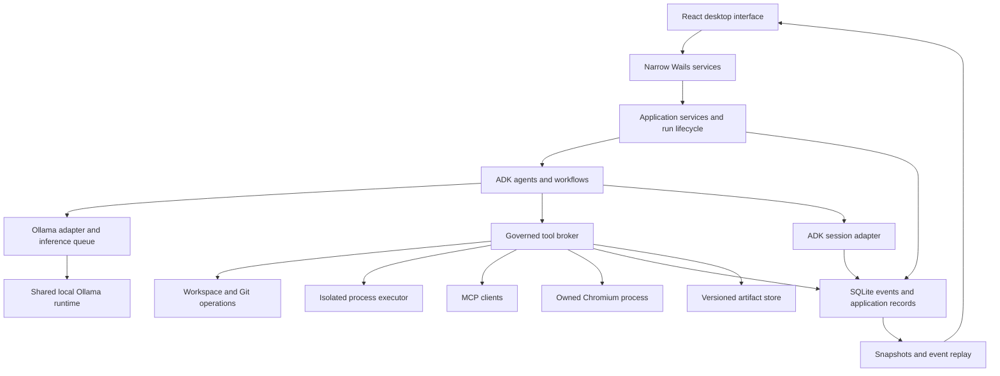

# Gemma Desktop research and build blueprint

Prepared for Daniel Mercado on 26 October 2026, before implementation kickoff.

Gemma Desktop's proposed Go, Wails, React, ADK, and Ollama architecture is viable. The important work is the integration between those components: preserving model tool-call state, enforcing permissions independently of the model, recording external effects, and recovering without repeating them. The build should retain the full product scope and resolve these boundaries before expanding every feature screen.

This research inspected current official documentation, tagged source, release notes, selected upstream implementations, and the local host. It produced documentation only. No application, inference benchmark, sandbox, or end-to-end workflow has been implemented or validated.

## Research map

| Document | Use during implementation |
| --- | --- |
| [ADK runtime](adk-runtime.md) | Actual Go APIs, release/main differences, graph restrictions, approvals, sessions, skills, compaction |
| [Inference and model management](inference-models.md) | Ollama protocol, Gemma thinking/tool cycles, lifecycle, context, locality, memory and metrics |
| [Desktop platform](desktop-platform.md) | Wails bindings/streams, WKWebView security, editor/terminal/graph integration, native packaging |
| [Execution security and persistence](security-and-persistence.md) | Tool governance, file changes, processes, MCP, browser isolation, SQLite and recovery |
| [Verification and Harness Lab](verification-plan.md) | Integration experiments, real product journeys, failure tests, evaluation design and release evidence |
| [Supplied specification](../reference/product-specification-v1.md) | Original product brief, preserved as reference material |
| [Concept image](../../design/reference/gemma-desktop-concept.png) | Original visual direction; practical changes described below |

## Findings that change the implementation plan

1. **Wails 3.0.0 is now a stable desktop release.** It was published on October 26, correcting the earlier discussion's beta assessment. Its iframe transport still allows access to bound methods, so arbitrary active content must not share the privileged app webview. [Release](https://github.com/wailsapp/wails/releases/tag/v3.0.0)
2. **ADK-Go v2 already supplies the requested graph machinery, with important edge cases.** Released v2.6.0 accepts conditional joins that can skip downstream work, does not cap dynamic children with the graph concurrency limit, and predates several resume/cancellation fixes. The final pin must follow a small conformance comparison against a reviewed fix-containing revision. [Join warning](https://github.com/google/adk-go/blob/v2.6.0/workflow/join_node.go), [release-to-main comparison](https://github.com/google/adk-go/compare/v2.6.0...219c13059ecf654b7318d5927a607779711943e0)
3. **A native Ollama adapter is preferable to a generic compatible API.** Gemma tool continuations need their current-turn thinking preserved; later user turns should omit historical thinking. Keep structured fields distinct and let Ollama handle model prompt rendering. [Renderer](https://github.com/ollama/ollama/blob/v0.40.11/model/renderers/gemma4.go), [model card](https://ai.google.dev/gemma/docs/core/model_card_4)
4. **Localhost is not proof of local inference.** Ollama can proxy cloud-backed models. A local-only policy checks model metadata and endpoint identity, and is verified with external networking disabled. [Authentication behavior](https://docs.ollama.com/api/authentication)
5. **The database dependency needs deliberate selection.** ADK selects modernc v1.46.1, whose documented Darwin SQLite engine is 3.51.2, below the WAL reset fix. Check the actual engine at startup and avoid importing two drivers that register the same `sqlite` name. [Driver documentation](https://pkg.go.dev/modernc.org/sqlite@v1.46.1), [SQLite fix](https://www.sqlite.org/wal.html#walresetbug)
6. **Apple containers do not run native macOS tasks.** They are a useful candidate for Linux execution isolation; native Xcode work needs a separate, qualified executor. Network isolation is an additional property to prove, not an automatic consequence of creating a container. [Apple container](https://github.com/apple/container/tree/1.6.1)
7. **Concurrent agents need shared resource admission and separate write ownership.** The proposed starting point is one inference request at a time, while safe reads and tool work can overlap. Independent mutating tasks use private snapshots/checkouts, and a reviewed integration step applies their results.
8. **Recovery has several meanings.** Conversation replay, resuming an ADK approval pause, restoring a file checkpoint, and reconciling an uncertain network write are different operations. The product must expose the correct one instead of treating every restart as a generic retry.

## Host readiness

Read-only observations from this research session:

| Item | Observed state | Build implication |
| --- | --- | --- |
| Hardware | Mac mini, Apple M4 Pro, 14 CPU cores, 64 GB unified memory | Good target for the proposed qualification matrix; actual memory pressure still measured |
| Operating system | arm64 macOS 27.0.1 | Primary local acceptance host; older macOS remains unqualified |
| Go | 1.26.2 | Needs a project-selected newer patched toolchain for the dependency candidates |
| Node / npm | 22.22.3 / 10.9.8 | Suitable starting build tooling; pin and lock frontend dependencies |
| Xcode | 27.1, build 27A9275; selected developer directory present | Native tools available; packaged build still must pass |
| Ollama CLI | 0.32.3 | Probe actual server/model requirements before deciding whether to upgrade |
| Ollama endpoint | Connection refused at 127.0.0.1:11434 | No local server or inference test in this research session |
| Wails CLI / Apple container CLI | Not found on inspected PATH | Setup tasks at kickoff, if selected |

The observed Ollama CLI version does not establish which models are already installed or which daemon version will run. No credentials, browser sessions, or private configuration were read for this inventory.

## Dependency selection

| Dependency | Research baseline | Selection rule |
| --- | --- | --- |
| Wails | v3.0.0, commit `7b11001b92b712210b27d8cb53430e83f67ad8e4` | Pin Go module, CLI and JS runtime together; prove native bridge and packaging |
| ADK-Go | v2.6.0, commit `5226417e7591bb75d680047b01578e0fa6078f09` | Compare with reviewed fix-containing commit before selecting final pin |
| Go toolchain | Wails/Ollama candidates specify 1.26.10 | Use a project-managed compatible patched toolchain; no silent system replacement |
| Ollama | v0.40.11, commit `675150d6ad2747df1e218ef59de9194bc4a7e538` | Candidate qualification runtime; installed 0.32.3 compatibility is still empirical |
| MCP Go SDK | v1.8.0 | Test both current 2026-07-28 and legacy protocol negotiation |
| Browser automation | chromedp v0.21.0 | Use its new API and matching cdproto; controlled Chromium profile |
| Execution isolation | Apple container 1.6.1 | Optional installed service; qualify files, signals, resource and network enforcement |
| SQLite | Exact driver unresolved | Select one registration and a fixed engine, matching dependencies and runtime version check |
| Frontend libraries | Candidate matrix in desktop report | Resolve peer dependencies and security patches once; commit exact lockfile |

A release number is a reproducible starting point, not evidence that all dependencies work together. Never use a generic GitHub latest-release result to choose the ADK major version: a newer release on the maintained v1 line can appear ahead of v2.

## Architecture and ownership

The initial system is a modular Go application embedded in Wails. A headless entry point uses the same application services for tests and future CLI operation. Introduce a separate background service only if work must survive explicit application Quit or require another client; closing a window while the app remains running is a simpler lifecycle requirement.



The run lifecycle service tracks admission, cancellation, ownership, and recovery. ADK schedules agent/workflow execution. React receives projections and sends commands. This keeps one execution scheduler while providing the durable host services it needs.

Proposed repository layout, to create during implementation:

```text
cmd/gemma-desktop/           Wails entry point and composition
cmd/gemma-headless/          Same core services without the desktop
internal/app/               Application commands, run lifecycle, ownership
internal/domain/            IDs, DTOs, events and shared contracts
internal/runtime/adk/       ADK construction and event/model/session adapters
internal/workflows/         Definition versions, validation and ADK compilation
internal/inference/ollama/  Native provider protocol and capabilities
internal/inference/admission/  Shared queue and model-call budgets
internal/models/            Catalog, discovery, pulls and suitability
internal/tools/             Registry, validated calls and structured results
internal/policy/            Decisions, scoped grants and durable approvals
internal/workspace/         Root handles, snapshots, edit sets and write leases
internal/git/               Controlled repository operations
internal/execution/         Process/PTY contract and isolation backends
internal/mcp/               Server configurations, sessions and tool adaptation
internal/browser/           CDP sessions and governed browser actions
internal/storage/           SQLite, migrations, queries and backup
internal/artifacts/         Local versioned content and ADK artifact adapter
internal/skills/            Imported instruction packages and provenance
internal/secrets/           Platform credential storage behind a narrow interface
internal/desktop/           Bound services, native menus/dialogs/window lifecycle
internal/diagnostics/       Redacted logs, metrics and support export
internal/evals/             Baselines, candidates, tasks, scoring and Harness Lab
frontend/src/app/           Shell, routing, panels and command palette
frontend/src/design/        Tokens, shared primitives and motion/contrast rules
frontend/src/features/      Workspace, chat, agents, runs, approvals, workflows,
                            models, tools, artifacts, editor, terminal, settings, lab
frontend/src/bridge/        Binding adapters, subscriptions and replay
build/darwin/               Bundle assets, metadata, entitlements and packaging
testdata/                   Small repositories, protocol fixtures and test sites
docs/                       Product, architecture, operation and verification
```

This is an ownership map, not an instruction to create empty packages. Introduce packages as working responsibilities emerge. Keep generated bindings separate from hand-written adapters. Avoid exporting raw runtime objects through Wails or sharing database models as frontend state.

## Contracts to settle first

| Contract | Essential content |
| --- | --- |
| Run request | Workspace/session, user task, immutable agent/workflow/model configuration, permissions and budgets |
| Execution event | Schema version, sequence, run/node/tool IDs, causal parent, committed state or bounded draft designation |
| Tool request | Stable call ID, tool/schema version, normalized arguments, workspace, expected revisions and environment |
| Policy decision | Allow/deny/approval, exact scope and request digest, source rule, expiry and revocation |
| Tool result | Structured output, bounded user/model summaries, artifact references, exit/error details, known or unknown outcome |
| Model stream | Separate text/thinking/tool proposals/usage, terminal completion, cancellation and provider metadata |
| Artifact | Immutable content version/hash, media type, source run, original workspace revision and verification evidence |
| Workflow definition | Version, stable node IDs, registered node types, routes/schemas, limits and display-only layout |

Preserve all required ADK event fields for resumption. Application events supplement them; they do not replace ADK state with a simplified progress list. App draft records handle partial text that ADK does not persist.

## Interface structure

The initial design assumption is to polish coding workflows first while keeping research, file work, and artifacts fully supported by the same architecture. The user has not yet chosen whether those activities should have equal prominence at launch; this assumption does not remove any required subsystem.

Use a compact sidebar for workspaces and navigation, a central conversation/results surface, a persistent composer, and a collapsible inspector with Activity, Graph, and Runtime views. Files, diffs, terminals, and artifacts open in work panes. Agent configuration and workflow editing are distinct: an agent can pursue an open-ended task, while a workflow defines explicit structure around agents and tools.

| Surface | Backend authority |
| --- | --- |
| Chats and activity | Session records, run events and tool outcomes |
| Agents | Versioned instructions, tools, model settings and execution limits |
| Workflow editor / graph | Validated definition / event-derived execution projection |
| Models | Actual Ollama inventory, observed capabilities and download/residency jobs |
| Tools | Local tools, MCP connections, browser and execution capabilities plus grants |
| Diffs and files | Captured before/after content and current workspace revisions |
| Artifacts | Versioned generated outputs, previews and file locations |
| Harness Lab | Fixed baseline/candidate configurations and reproducible task evidence |
| Settings | User-owned defaults, privacy, execution policy, storage and diagnostics |

Keep the charcoal/electric-blue identity, quieter orbital details, restrained borders, and generous typography. Remove decorative green connected/live dots. Status labels should explain the task: queued, loading, inspecting, waiting for approval, testing, interrupted, or complete. Completion presents deliverables and verification evidence together. Avoid duplicating activity in several always-visible panels.

## Build sequence and parallel work

1. Preserve this research, agree on event/tool/approval contracts, and choose candidate pins.
2. Run the six integration experiments in the verification plan. Establish a packaged native window, real Gemma tool loop, reliable session persistence, and qualified execution/preview boundaries.
3. Complete the first full coding journey: inspect, propose, authorize, edit, test, review, restart, and recover. Use this to integrate the visual system early.
4. Expand the complete navigation and management experience, reusable agents, skills, model management, and artifact handling.
5. Add advanced graphs, dynamic delegation, robust pause/resume, MCP and browser operations to the same contracts.
6. Complete Harness Lab, diagnostics, accessibility, distribution scripts, documentation and final native/end-to-end verification.

After kickoff, milestones organize continuous implementation; they are not automatic handoff points. The completed product still includes the full required scope from the supplied brief.

Use three concurrent specialist lanes plus one integration owner. Early ownership: runtime/models, tools/storage/security, and desktop. Define shared interfaces before parallel edits, keep changes scoped, and integrate working increments frequently. Later rotate specialists into independent failure testing and release verification. Parallel implementation and parallel local inference are separate resource decisions.

## Upstream reference disposition

| Reference | What to use |
| --- | --- |
| [ADK-Go](https://github.com/google/adk-go) and [ADK docs](https://adk.dev/llms-full.txt) | Reuse runtime APIs; verify language and release-specific support against tagged source |
| [Ollama](https://github.com/ollama/ollama), [API](https://docs.ollama.com/api), [Gemma catalog](https://ollama.com/library/gemma4) | Runtime/process remains external; integrate native protocol and actual model metadata |
| [Wails](https://v3.wails.io/) | Desktop shell, native behavior and transport; retain content boundary limitations |
| [MCP Go SDK](https://github.com/modelcontextprotocol/go-sdk) | Reuse protocol/transport/authentication machinery; app still owns authorization |
| [Gemini CLI](https://github.com/google-gemini/gemini-cli/tree/363a13119a57354f469732577518b9d6b319d1d6) | Policy/tool contracts, checkpoints and recovery patterns; no wholesale port |
| [Qwen Code](https://github.com/QwenLM/qwen-code/tree/34769f9d41a1ea253a000285f3c32e60fac6fb26) | Prior-read checks, exact replacement, encoding and stale-edit handling |
| [OpenWork](https://github.com/different-ai/openwork) | Workspace/artifact/capability organization; current architecture differs from this project's stack |
| [OpenWorker](https://github.com/andrewyng/openworker) | Separation of executor, credentials and audit records; qualify any borrowed isolation assumptions |
| [Harness²](https://github.com/google-research/harness2/tree/1cfe254e8d25b15f37048c3730134686abe60335) | Experiment configuration, baseline/candidate comparison and evidence-driven refinement |
| [A2A Go](https://github.com/a2aproject/a2a-go) | Future remote-agent interoperability through ADK; local delegation does not require it |
| [Gemma visual reference](https://deepmind.google/models/gemma/) | General palette/visual atmosphere, with original app assets and no endorsement implication |

References are design/source material, not installation instructions. Preserve licenses and attribution when incorporating code or assets. OpenWork currently documents a directory-split license, with separate terms under `ee/`; inspect the exact file and revision before copying. UI ideas alone do not require adopting another product's runtime, cloud services, or account model. [OpenWork licensing section](https://github.com/different-ai/openwork#licensing)

## Decisions that remain empirical

The research does not leave a fundamental stack blocker. The final ADK revision, SQLite driver, minimum supported macOS version, strongest usable native executor, exact frontend lockfile, and model/context performance profile need the initial integration experiments. Selective failure must disable or restrict the affected capability rather than silently weaken its guarantee.

Product preferences can be settled during our kickoff discussion: the prominence of coding versus general work, whether tasks should survive explicit Quit, and whether a future optional cloud mode is desirable. The proposed defaults are coding-first presentation, work continuing only while the app process runs, and local-only inference with no automatic cloud fallback.
